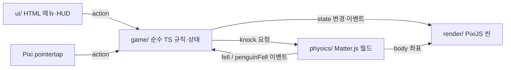
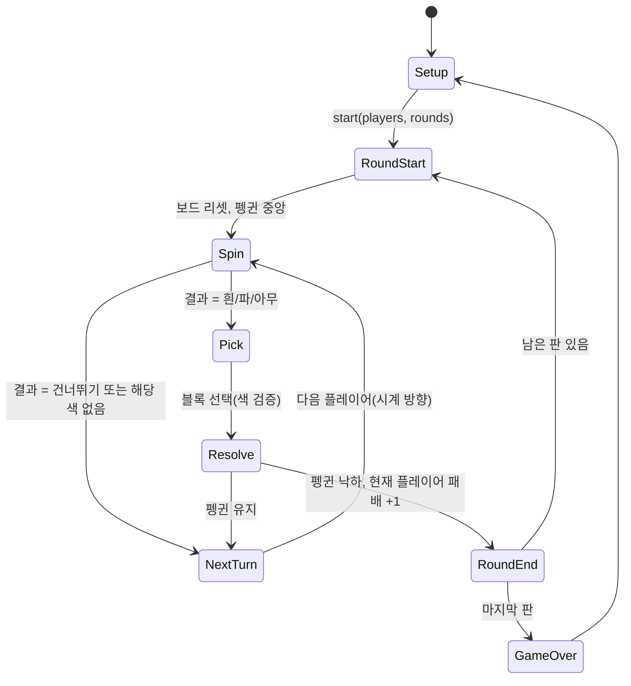

# 펭귄 얼음 깨기 (가칭) 브라우저 보드게임 기획안

작성일: 2026-10-22

원작: 스핀마스터 「펭귄 얼음 깨기」 (코리아보드게임즈 유통, 2~4인, 8세+, 15분). 원작 이미지·로고·상품명은 저작권이 있어 그대로 쓰지 않고, 규칙만 참고한다. 공개 시 표시명은 따로 정한다.

## 1. 목표와 범위

* 크롬 등 모던 브라우저(데스크톱 + 모바일 터치)에서 동작하는 2D 게임
* 1차 범위: 로컬 핫시트(한 기기에서 2~4명이 번갈아 플레이)
* 2차 범위(1차 완료 후): 로컬 AI 상대, 온라인 멀티플레이
* 핵심 재미: 블록을 하나씩 깰 때마다 펭귄이 떨어질지 모르는 긴장감. 이를 2D 물리 시뮬레이션으로 재현한다

## 2. 원작 규칙 정리

구성: 육각 얼음판, 육각 얼음 블록(흰색·파란색), 펭귄 말 1개, 망치, 룰렛.

1. 얼음판에 블록을 색 상관없이 모두 끼우고 중앙에 펭귄을 올린다
2. 시계 방향으로 차례를 진행한다. 자기 차례에 룰렛을 돌리고 결과에 따른다
   * 흰색: 흰색 블록 1개 제거
   * 파란색: 파란색 블록 1개 제거
   * 아무 색깔: 아무 블록 1개 제거
   * 차례 건너뛰기: 아무것도 하지 않음
3. 블록을 망치로 쳐서 떨어뜨린다. 이때 펭귄이 떨어지면 그 사람이 패배
4. 여러 판을 하고 펭귄을 가장 적게 떨어뜨린 사람이 최종 승리

## 3. 결정 사항 (인터뷰 결과)

| 항목 | 결정 | 근거 |
| --- | --- | --- |
| 플레이 모드 | 로컬 핫시트 먼저, AI 상대·온라인은 이후 | 서버 없이 정적 배포로 끝낼 수 있음. 규칙 로직을 순수 TS로 분리해 확장 여지 확보 |
| 낙하 판정 | 2D 물리 시뮬레이션 (Matter.js) | 원작의 "아슬아슬함"을 결정론적 규칙만으로는 재현하기 어려움 |
| 프레임워크 | Vite + TypeScript + PixiJS 8 + Matter.js | Godot는 웹 결과물이 수십 MB에 Safari/iOS 리스크가 있고, 이 규모(화면 1개, 오브젝트 40개)에선 장점이 쓰이지 않음 |
| 망치 조작 | 블록 클릭 한 번 + 물리 충격 | 터치에서도 단순. 운은 물리가 담당 |
| 아트 에셋 | AI 생성 이미지 (PNG 스프라이트) | 4장 참조 |
| 배포 | Vercel 정적 배포, GitHub 푸시 시 자동 | |
| 지원 기기 | 데스크톱 마우스 + 모바일 터치, 가로·세로 모두 | 처음부터 포인터 이벤트와 반응형 스케일 적용 |
| 라운드 | 게임 시작 시 판 수 설정(기본 3), 매 판 패자 기록, 패배 수 최소가 승리. 동점은 공동 승리 | 원작 권장 방식 |

인터뷰에서 다루지 않아 기본값으로 정한 것:

* 룰렛 네 칸은 균등 확률(각 25%). 튜닝 가능하게 상수로 둔다
* 룰렛 결과 색의 블록이 하나도 남지 않았으면 "차례 건너뛰기"로 처리한다
* 펭귄이 올라간 블록도 선택할 수 있다(원작에서도 금지하지 않음. 거의 확실히 지는 수)
* 다음 판은 직전 판 패자가 먼저 시작한다
* 블록 수는 반지름 3 육각 그리드 37개(1+6+12+18), 흰색·파란색을 무작위로 반씩 배치한다. 원작 사진과 맞춰 조정 가능

## 4. 아트 에셋 규격

AI 이미지 생성 도구로 만들고, 배경 제거 후 투명 PNG로 저장한다. 스타일은 "플랫 카툰, 굵은 외곽선, 파스텔 블루 팔레트"로 통일한다. 리뷰에 "색 구별이 더 뚜렷했으면" 이라는 의견이 있으니 흰색·파란색 블록 대비를 높인다.

| 에셋 | 파일 | 크기 | 비고 |
| --- | --- | --- | --- |
| 흰색 얼음 블록 | `block-white.png` | 256×256 | 탑뷰 육각, 살짝 입체감 |
| 파란색 얼음 블록 | `block-blue.png` | 256×256 | 같은 형태, 색만 다름 |
| 블록 파편 | `shard-1..3.png` | 128×128 | 낙하 파티클용 |
| 펭귄 | `penguin-idle.png`, `penguin-wobble.png`, `penguin-fall.png` | 256×256 | 3 포즈. 흔들림은 코드 회전으로 보강 |
| 망치 | `hammer.png` | 256×256 | 손잡이 기준점 좌하단 |
| 룰렛 판 | `roulette-base.png` | 512×512 | 4등분 색면 + 아이콘 |
| 룰렛 화살표 | `roulette-arrow.png` | 512×512 | 중심 회전 |
| 얼음판 프레임 | `frame.png` | 1024×1024 | 육각 테두리, 안쪽 투명 |
| 바다 배경 | `bg.png` | 1024×1024 | 타일 가능한 패턴 |

에셋이 준비되기 전에는 PixiJS Graphics로 그린 도형 플레이스홀더로 개발한다.

## 5. 기술 스택

| 영역 | 선택 |
| --- | --- |
| 런타임/빌드 | Node 24, npm, Vite 8, TypeScript 7 (strict) |
| 렌더링 | pixi.js 8 (WebGL, WebGPU 자동 선택) |
| 물리 | matter-js |
| UI (메뉴·HUD) | 일반 HTML/CSS 오버레이. 게임 캔버스 위에 배치 |
| 테스트 | vitest (규칙·상태 머신·물리 결정성) |
| 배포 | Vercel 정적 사이트 |

추가 의존성은 두지 않는다. 트윈은 30줄짜리 헬퍼로 쓰고, 사운드는 2차 범위에서 `@pixi/sound`를 검토한다.

## 6. 아키텍처



* `game/`: PixiJS·Matter를 import하지 않는 순수 모듈. `reduce(state, action) → state`와 이벤트. 시드 가능한 RNG. 이후 온라인 서버에서 그대로 재사용한다
* `physics/`: 보드 물리 월드. `knock(blockId, seed)`를 받아 낙하한 블록 목록과 펭귄 낙하 여부를 돌려준다
* `render/`: 상태와 물리 좌표를 받아 그리기만 한다. 애니메이션(망치, 흔들림, 낙하, 룰렛 회전)은 여기서
* `ui/`: 설정 화면(인원·이름·판 수), 턴 표시, 룰렛 결과, 점수판, 결과 화면. HTML이라 접근성·반응형이 쉽다
* 입력: 블록은 Pixi `pointertap`(마우스·터치 공통), 버튼은 HTML. 별도 입력 모듈은 두지 않는다

디렉터리:

```text
src/
  main.ts  style.css
  game/        types.ts  rng.ts  hexgrid.ts  rules.ts  reducer.ts
  physics/     world.ts  support.ts  params.ts            (M2)
  render/      board.ts  penguin.ts  hammer.ts  roulette.ts  tween.ts
  ui/          hud.ts  setup.ts  result.ts
  assets/      (PNG)
tests/         rules.test.ts  reducer.test.ts  physics.test.ts
```

## 7. 게임 상태 머신



상태 타입(요지):

```ts
type Color = 'white' | 'blue'
type Spin = Color | 'any' | 'skip'
interface Block { id: number; q: number; r: number; color: Color; alive: boolean }
interface GameState {
  phase: 'setup' | 'spin' | 'pick' | 'resolve' | 'roundEnd' | 'gameOver'
  players: { name: string; losses: number }[]
  current: number
  round: number; totalRounds: number
  blocks: Block[]; penguinBlock: number
  spin?: Spin
  seed: number
}
```

## 8. 물리 모델 (핵심)

원작은 3D 현상(블록끼리 마찰로 끼어 있고, 펭귄이 그 위에 서 있음)이라 2D 엔진이 그대로 흉내 낼 수 없다. 탑뷰 2D 물리 + 지지 그래프를 결합한다.

* 월드: 탑뷰 평면, 중력 0. 블록은 육각 동적 바디(회전 없음). 프레임 바디는 두지 않고, 가장자리 블록을 제자리에 스프링으로 고정해 "프레임에 끼어 있음"을 표현한다
* 이웃한 블록끼리 `Matter.Constraint`(스프링)로 잇는다. 이 제약이 "서로 끼어 있는 마찰"을 대신한다. 모든 블록에는 지지와 무관한 약한 제자리 스프링도 있어, 끊긴 뒤에도 격자로 돌아온다(시각용)
* 망치 타격: 대상 블록을 월드에서 제거하고, 그 위치에서 이웃 블록에 바깥 방향 속도를 준다(세기·방향에 시드 난수). 매 스텝 제약이 임계치 이상 늘어나면 끊어진다
* 지지 판정: 매 스텝 "살아 있는 제약을 따라 가장자리 고정 블록까지 이어지는가"를 BFS로 검사한다. 이어지지 않는 블록은 그 스텝에 떨어진다(연쇄 낙하). 펭귄이 선 블록이 떨어지면 펭귄 낙하
* 결과: 떨어진 블록 목록(프레임 번호 포함)과 스텝별 좌표. 렌더는 이 프레임을 재생만 한다
* 흔들림 연출: 펭귄 블록의 남은 이웃 수가 적을수록 펭귄을 더 크게 흔든다(시각 효과, 판정과 무관)
* 결정성: 고정 timestep, 시드 RNG. 같은 시드·같은 입력이면 같은 결과가 나온다(테스트로 보장). 온라인 전환 시 서버가 결과를 계산해 배포하는 근거가 된다

튜닝 상수는 `physics/params.ts`에 모은다. 1차 값(stiffness 0.08, impulse 14, breakStretch 6)은 무작위 합법 플레이 80판 시뮬레이션으로 골랐다: 펭귄 낙하까지 타격 수 p10/p50/p90 = 9/12/16, 최소 3, 첫 타격 연쇄 낙하 6%. 딱딱한 스프링(0.3 이상)은 늘어남이 1px 수준이라 끊김이 전혀 없어 순수 연결 규칙(중앙값 25회)만 남는다. 주의: `Bodies.polygon`은 기본이 pointy-top이라 추가 회전을 주면 안 된다(가로 이웃이 겹쳐 격자가 압축된다). 실제 플레이테스트로 "3~4명이 10번 정도 치면 긴장감이 생기는" 수준을 맞춘다(dev 서버의 물리 튜닝 패널).

대안: 튜닝이 길어지면 제약 끊김을 빼고 "이웃 N개 미만이면 낙하" 규칙으로 축소할 수 있다. 지지 그래프 코드는 그대로 쓰인다.

## 9. 화면과 입력

* 논리 해상도 1080×1080 보드를 뷰포트에 맞춰 축소·확대. HUD는 HTML이라 별도 스케일 불필요
* 세로 화면: 보드 위, HUD 아래. 가로 화면: 보드 왼쪽, HUD 오른쪽. CSS flex로 전환
* 차례 흐름: "룰렛 돌리기" 버튼 탭 → 화살표 회전 애니메이션(1.5초) → 결과 표시 → 선택 가능한 블록만 하이라이트 → 블록 탭 → 망치 내려침(0.3초) → 블록 낙하·파편 → 펭귄 반응
* 터치 영역: 블록 지름 최소 44px 이상이 되도록 보드 크기 하한을 둔다
* 접근성 기본: 색 외에 흰색/파란색 블록에 작은 아이콘 차이를 둔다. 버튼은 실제 `<button>`

## 10. 테스트

* `rules.test.ts`: 룰렛 결과별 선택 가능 블록, 색 없을 때 건너뛰기, 차례 순환, 패배 집계와 승자 판정(동점 포함)
* `reducer.test.ts`: 상태 전이 전체 시나리오 1개(3판 게임을 끝까지)
* `physics.test.ts`: 지지 BFS, 같은 시드로 두 번 돌려 결과 동일, 이웃 6개 제거 시 낙하, 펭귄 외 블록 전부 제거 시 펭귄 반드시 낙하, 첫 타격 펭귄 낙하·연쇄가 드묾(100회 시뮬)
* E2E는 두지 않는다. 필요해지면 Playwright 스모크 1개

## 11. 마일스톤

| 단계 | 산출물 | 완료 기준 |
| --- | --- | --- |
| M1 뼈대 | Vite 프로젝트, 육각 그리드 렌더(도형), 규칙 모듈 + 테스트, 핫시트 턴 진행(낙하는 임시 규칙) | 2명이 끝까지 한 판 진행 (완료 2026-10-22) |
| M2 물리 | Matter 월드, 타격·연쇄 낙하·펭귄 낙하, 결정성 테스트, 파라미터 튜닝 | 10판 플레이해 긴장감 확인 (구현 완료 2026-10-22, 플레이테스트 남음) |
| M3 게임 완성 | 룰렛, 설정 화면, HUD, N판·점수, 결과 화면, 모바일 레이아웃 | 4명 3판 풀게임 |
| M4 마감 | AI 에셋 적용, 애니메이션·파편, 사운드(선택), Vercel 배포 | 공개 URL |
| M5 확장(2차) | AI 상대(지지 그래프 기반 휴리스틱), 온라인(서버가 같은 reducer 실행, 물리 결과 배포) | 별도 기획 |

## 12. 리스크

* 물리 튜닝이 재미를 좌우한다. M2에서 파라미터를 바꾸며 즉시 플레이할 수 있는 디버그 패널을 만든다
* AI 생성 에셋의 스타일 불일치. 같은 프롬프트 접두사와 참조 이미지를 고정하고, 블록처럼 반복되는 에셋은 1장만 만들어 코드로 색을 바꾼다
* Safari의 WebGL 메모리 제한. 텍스처는 1024px 이하로 유지한다
